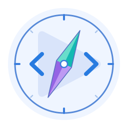
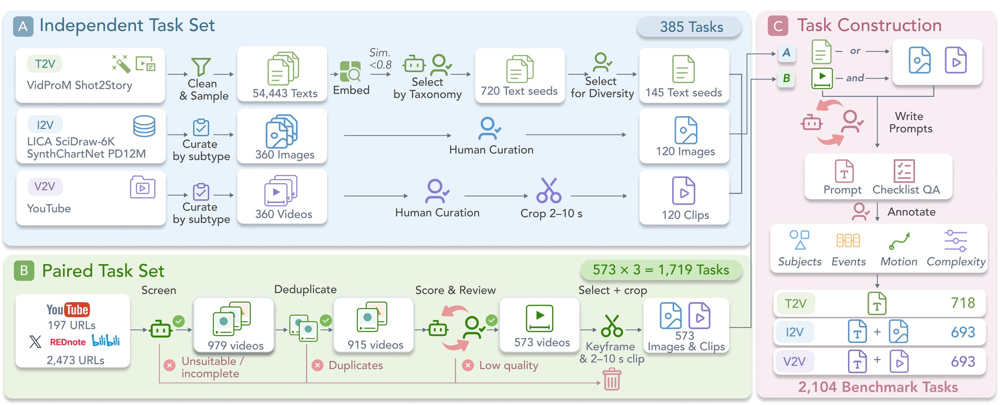

<p align="center">
  
</p>

<h1 align="center">Code2Video-Compass</h1>
<p align="center">A Comprehensive Benchmark for General-Purpose Code-Based Video Generation across T2V, I2V, and V2V</p>
<p align="center">Zhenghan Chen, Zekai Shao, Xin Lin, Leting Cheng, and Siming Chen</p>
<p align="center">
  <a href="https://code2video-compass.github.io/"></a>
  <a href="https://arxiv.org/abs/2610.28416"></a>
  <a href="https://huggingface.co/datasets/code2video-compass/Code2Video-Compass"></a>
</p>

<p align="center">
  
</p>

## 🎉 What's New

- [2026.10] 📣 Code2Video-Compass dataset and codebase are released.

## 🎏 Introduction

Code2Video-Compass evaluates general-purpose code-based video generation from text instructions and optional image or video references. Models create executable video code using HTML/CSS, SVG, Canvas, and Three.js, rendered through Remotion.

<p align="center">
  
</p>

- **2,104 tasks** across **10 video categories** and **24 subtypes**.
- **T2V, I2V, and V2V**, combining independent and source-video-paired tasks.
- **12 objective and five subjective metrics** for execution, efficiency, quality, alignment, reference fidelity, and instruction following.
- **15 MLLMs** in the evaluation lineup.

This repository contains the **evaluation code**. Benchmark task tables (prompts, annotations, QA checklists, reference media URLs, and timestamps) are available on Hugging Face: [code2video-compass/Code2Video-Compass](https://huggingface.co/datasets/code2video-compass/Code2Video-Compass).

## 📚 Dataset

| Task set | T2V | I2V | V2V | Total |
|---|---:|---:|---:|---:|
| Independent | 145 | 120 | 120 | 385 |
| Source-video-paired | 573 | 573 | 573 | 1,719 |
| **Total** | **718** | **693** | **693** | **2,104** |

The distributions cover 958 records (573 paired sources + 385 independent tasks). Video categories, motion types, and subject types allow multiple labels.

<p align="center">
  
</p>
<p align="center"><sub>Data construction pipeline. (A) Independent tasks are developed from curated text seeds, images, and video clips. (B) Paired tasks share a complete source video across T2V, I2V, and V2V. (C) Both sets undergo prompt construction, QA checklist development, and annotation, yielding 2,104 tasks.</sub></p>

## 🧭 Evaluation

The evaluation workflow is:

1. Load the T2V, I2V, or V2V task tables from Hugging Face and prepare the prescribed reference media for conditioned tasks.
2. Run your own generation model with each task's `prompt` and, for I2V/V2V, its reference image/clip. Render the generated code locally and keep a result directory for every attempted task, including failures.
3. Organize the rendered videos, provider usage records, and benchmark inputs using the [local input layout](evaluation/README.md#2-organize-local-files). Use the same Hugging Face `sample_id` throughout.
4. Install each metric's dependencies and run its local scoring script. Run Sequence Alignment (08) before Appearance Fidelity (09) and Motion Fidelity (10). IF (11) and holistic quality (12) use Gemini API calls; the other metrics compute scores locally after their dependencies and weights are available.

`evaluation/` holds one folder per metric entry point, in benchmark order:

| # | Folder | Metric(s) | Level |
|---|--------|-----------|-------|
| 01 | [`01_execution_success_and_token_consumption`](evaluation/01_execution_success_and_token_consumption/README.md) | Execution Success (ES), Token Consumption (TC) | objective |
| 02 | [`02_technical_quality`](evaluation/02_technical_quality/README.md) | Technical Quality (TQ) | objective |
| 03 | [`03_aesthetic_quality`](evaluation/03_aesthetic_quality/README.md) | Aesthetic Quality (AQ) | objective |
| 04 | [`04_motion_smoothness`](evaluation/04_motion_smoothness/README.md) | Motion Smoothness (MS) | objective |
| 05 | [`05_local_tvalign`](evaluation/05_local_tvalign/README.md) | Local TVAlign (L-TVA) | objective |
| 06 | [`06_global_tvalign`](evaluation/06_global_tvalign/README.md) | Global TVAlign (G-TVA) | objective |
| 07 | [`07_image_fidelity`](evaluation/07_image_fidelity/README.md) | Perceptual Fidelity (PF), Structural Fidelity (SF) | objective |
| 08 | [`08_sequence_alignment`](evaluation/08_sequence_alignment/README.md) | Sequence Alignment (SA) | objective |
| 09 | [`09_appearance_fidelity`](evaluation/09_appearance_fidelity/README.md) | Appearance Fidelity (AF) | objective |
| 10 | [`10_motion_fidelity`](evaluation/10_motion_fidelity/README.md) | Motion Fidelity (MF) | objective |
| 11 | [`11_instruction_following`](evaluation/11_instruction_following/README.md) | Instruction Following (IF) | subjective |
| 12 | [`12_holistic_video_quality`](evaluation/12_holistic_video_quality/README.md) | Content Coherence (NC), Visual Design (VD), Motion Quality (MQ), Viewer Engagement (VE) | subjective |

See [evaluation/README.md](evaluation/README.md) for the input layout, per-metric
dependencies, checkpoints, and run commands.

## Citation

If you find Code2Video-Compass useful, please consider citing our paper:

```bibtex
@misc{chen2026code2videocompasscomprehensivebenchmarkgeneralpurpose,
      title={Code2Video-Compass: A Comprehensive Benchmark for General-Purpose Code-Based Video Generation across T2V, I2V, and V2V},
      author={Zhenghan Chen and Zekai Shao and Xin Lin and Leting Cheng and Siming Chen},
      year={2026},
      eprint={2610.28416},
      archivePrefix={arXiv},
      primaryClass={cs.CV},
      url={https://arxiv.org/abs/2610.28416}
}
```

## 💬 Contact

If you have any questions about Code2Video-Compass, feel free to reach out to us at [chenzh26@m.fudan.edu.cn](mailto:chenzh26@m.fudan.edu.cn).

## 📌 License

The code is released under Apache-2.0. The dataset is released separately under CC BY-NC 4.0.
